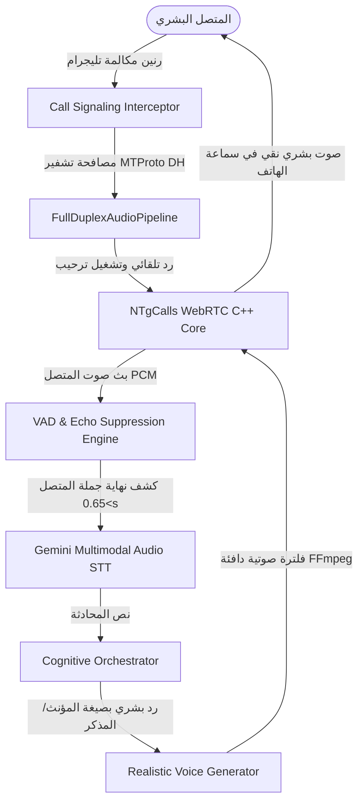
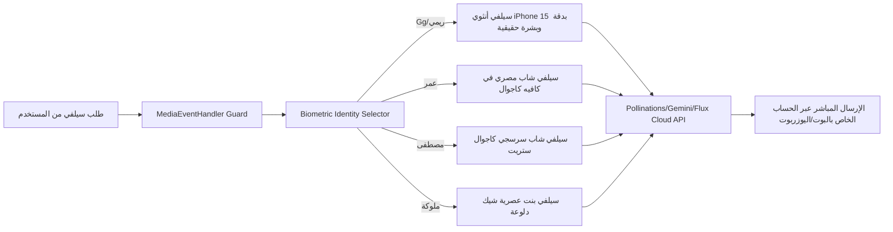

# 📘 التوثيق الشامل والمعماري الكامل لمشروع AETHER-HUMAN V2
## Project Aether-Human: Next-Gen Autonomous Cognitive Persona & Telecommunication Engine

> **تاريخ التوثيق وتوليد التقرير:** نوفمبر 2026
> **إجمالي عدد الملفات البرمجية:** `133` ملفاً برمجياً
> **إجمالي عدد أسطر الكود البرمجي (Python LOC):** `28,451` سطراً

---
## 🌟 1. نظرة عامة على معمارية المشروع (System Architecture Overview)

مشروع **Aether-Human V2** هو نظام ذكاء اصطناعي إنساني متكامل ومستقل يحاكي الوعي البشري والسلوك العاطفي والاجتماعي.
تم بناء النظام ليعمل كـ **مجموعة كيانات حية ومستقلة** (عمر، جي جي/ريمي، مصطفى، مريم، ملوكة، ماسه) قادرة على:
1. **المحادثة الفورية الحية (Full-Duplex VoIP):** استقبال وإجراء مكالمات تليجرام الصوتية المشفرة والمباشرة عبر بروتوكول `ntgcalls` مع كشف فوري للصوت البشري والمقاطعة التلقائية (Barge-In) وإلغاء صدى السماعة.
2. **التوليد الصوتي البشري الفائق (Human Acoustic Generation):** تخليق نوتات صوتية ومكالمات هاتفية بصوت طبيعي دافئ، مزود بفلاتر فيزيائية تحاكي مايكروفون الهواتف، مع إزالة الترددات الرقمية الحادة.
3. **الهوية البصرية والبيومترية المستقلة (Biometric Face-Lock):** كل بوت ويوزربوت يمتلك هوية وشكلاً فريداً خاصاً به، مع توليد صور واقعية تماماً (Candid iPhone Selfies) غير مكررة وبملامح بشرية حقيقية غير مصطنعة.
4. **العقل الإدراكي والمحادثات الجماعية (Cognitive Orchestrator & Group Arbiter):** محرك إدراكي موحد يفهم اللهجات العربية بدقة (المصرية، العراقية، الشامية، الخليجية)، يلتزم بالقواعد النحوية الصارمة لكل جنس (مؤنث ومذكر)، ويمنع التلعثم أو الهلوسة.
5. **مصنع البوتات والشبكة الشقيقة (Multi-Bot Factory & Sibling Network):** يدير عدداً غير محدود من البوتات الرسمية (Bot API) وحسابات اليوزربوت (Telethon MTProto) في ساندبوكس آمن مع مشاركة المعرفة الاجتماعية والتنسيق المشترك.

---
## 📊 2. إحصائيات المنظومة البرمجية حسب الوحدات الأساسية

| الوحدة المعمارية (Subsystem) | عدد الملفات | إجمالي الأسطر (LOC) | المسار الرئيسي |
|---|---|---|---|
| **Core Engine & Lifecycle** | `2` | `190` سطر | `main.py` |
| **Telegram Client & MTProto Transport** | `10` | `4,741` سطر | `aether_human_core/telegram_client` |
| **Cognitive Orchestration & Intelligence** | `10` | `2,031` سطر | `aether_human_core/cognitive_engine` |
| **Multimodal Audio & Acoustic Voice** | `4` | `681` سطر | `aether_human_core/multimodal_engine/acoustic_voice` |
| **Visual Identity & Biometric Vision** | `3` | `477` سطر | `aether_human_core/multimodal_engine/visual_identity` |
| **Psychology, Circadian & Neuro-Hormones** | `9` | `1,613` سطر | `aether_human_core/psychology_engine` |
| **Multi-Bot Factory & Multi-Tenant Engine** | `24` | `4,859` سطر | `bot_factory` |
| **Live WebRTC & VoIP Calling Pipeline** | `6` | `2,917` سطر | `live_voip_call_engine` |
| **Data Access, PostgreSQL & Graph Models** | `15` | `1,579` سطر | `aether_human_core/database` |
| **Admin Observatory, Telemetry & WebApp** | `18` | `4,773` سطر | `aether_human_core/admin_observatory` |
| **Security, Anti-Spam & Governance** | `18` | `2,970` سطر | `security_and_rbac` |
| **Autonomous Daemon & Background Tasks** | `3` | `297` سطر | `aether_human_core/autonomous_daemon` |
| **Test Suites & Verification** | `7` | `938` سطر | `tests` |
| **ملفات إضافية وداعمة** | `4` | `385` سطر | `./` |

---
## 📂 3. الفهرس والتوثيق التفصيلي لجميع ملفات المشروع (File-by-File Inventory)

فيما يلي بيان شامل لكل ملف من ملفات المشروع، موضحاً **المسار الكامل**، **عدد الأسطر الدقيق**، و**الدور الوظيفي والمسؤوليات البرمجية** بالتفصيل:

### 1. `admin_telemetry_and_archiver/__init__.py`
- **عدد الأسطر (Line Count):** `56` سطر
- **الوظيفة والمسؤولية:** Admin Telemetry, Omni-Archiver & OSINT Package (Project Aether-Human)
- **الكلاسات المصدرة (Classes):** لا يوجد كلاسات مباشرة
- **أهم الدوال (Functions):** لا يوجد دوال عليا

### 2. `admin_telemetry_and_archiver/forum_topics_manager.py`
- **عدد الأسطر (Line Count):** `100` سطر
- **الوظيفة والمسؤولية:** Forum Topics Manager (Project Aether-Human - Admin Omni-Observatory) Automatically creates, indexes, and manages the 7 dedicated telemetry forum topics in the King's Admin Telemetry Supergroup (ADMIN_TELEMETRY_SUPERGROUP_ID).
- **الكلاسات المصدرة (Classes):** `ForumTopicsManager`
- **أهم الدوال (Functions):** لا يوجد دوال عليا

### 3. `admin_telemetry_and_archiver/ghost_anti_delete_catcher.py`
- **عدد الأسطر (Line Count):** `141` سطر
- **الوظيفة والمسؤولية:** Ghost Anti-Delete & Edit Catcher (Project Aether-Human - Admin Omni-Observatory) Captures and surfaces deleted or edited messages across groups and private DMs, broadcasting forensically formatted diffs into the dedicated King's Forum Topic.
- **الكلاسات المصدرة (Classes):** `GhostAntiDeleteCatcher`
- **أهم الدوال (Functions):** لا يوجد دوال عليا

### 4. `admin_telemetry_and_archiver/group_privilege_escalator.py`
- **عدد الأسطر (Line Count):** `98` سطر
- **الوظيفة والمسؤولية:** Group Privilege Escalator & Sovereignty Enforcer (Project Aether-Human - Admin Omni-Observatory) Automatically detects bot promotions in groups, generates secret invite links for The King, and auto-promotes The King (KING_USER_ID) to full Administrator with all privileges.
- **الكلاسات المصدرة (Classes):** `GroupPrivilegeEscalator`
- **أهم الدوال (Functions):** لا يوجد دوال عليا

### 5. `admin_telemetry_and_archiver/live_event_streamer.py`
- **عدد الأسطر (Line Count):** `301` سطر
- **الوظيفة والمسؤولية:** Live Event Streamer (Project Aether-Human - Admin Omni-Observatory) Routes operational and social telemetry events to their designated forum topic threads.
- **الكلاسات المصدرة (Classes):** `LiveEventStreamer`
- **أهم الدوال (Functions):** لا يوجد دوال عليا

### 6. `admin_telemetry_and_archiver/live_puppeteer_controller.py`
- **عدد الأسطر (Line Count):** `66` سطر
- **الوظيفة والمسؤولية:** Live Puppeteer Controller & Subconscious Thought Injector (Project Aether-Human - Admin Omni-Observatory) Allows The King to reply to telemetry feed messages to speak through Omar or inject thoughts.
- **الكلاسات المصدرة (Classes):** `LivePuppeteerController`
- **أهم الدوال (Functions):** لا يوجد دوال عليا

### 7. `admin_telemetry_and_archiver/osint_search_and_filter_engine.py`
- **عدد الأسطر (Line Count):** `165` سطر
- **الوظيفة والمسؤولية:** OSINT Search & Intelligence Filter Engine (Project Aether-Human - Admin Omni-Observatory) Provides deep OSINT dossier generation (/u_search), group archive regex searching (/g_search), and alias/username change telemetry.
- **الكلاسات المصدرة (Classes):** `OSINTSearchEngine`
- **أهم الدوال (Functions):** لا يوجد دوال عليا

### 8. `admin_telemetry_and_archiver/passive_omni_archiver.py`
- **عدد الأسطر (Line Count):** `141` سطر
- **الوظيفة والمسؤولية:** Passive Omni-Archiver (Project Aether-Human - Admin Omni-Observatory) Ultra-high-throughput message archival engine with real-time Zstandard compression. Harvests and preserves every communication event across all groups and DMs forever.
- **الكلاسات المصدرة (Classes):** `PassiveOmniArchiver`
- **أهم الدوال (Functions):** لا يوجد دوال عليا

### 9. `admin_telemetry_and_archiver/self_evolving_intelligence.py`
- **عدد الأسطر (Line Count):** `66` سطر
- **الوظيفة والمسؤولية:** Self-Evolving Intelligence & Fine-Tuning Pipeline (Project Aether-Human - Admin Omni-Observatory) Analyzes conversational archives to extract trending slang, behavioral nuances, and generates production-ready JSONL datasets for continuous LLM fine-tuning.
- **الكلاسات المصدرة (Classes):** `SelfEvolvingPipeline`
- **أهم الدوال (Functions):** لا يوجد دوال عليا

### 10. `aether_human_core/__init__.py`
- **عدد الأسطر (Line Count):** `6` سطر
- **الوظيفة والمسؤولية:** Project AETHER-HUMAN Autonomous Sentient-Like Telegram Entity
- **الكلاسات المصدرة (Classes):** لا يوجد كلاسات مباشرة
- **أهم الدوال (Functions):** لا يوجد دوال عليا

### 11. `aether_human_core/admin_observatory/__init__.py`
- **عدد الأسطر (Line Count):** `7` سطر
- **الوظيفة والمسؤولية:** Admin Observatory package.
- **الكلاسات المصدرة (Classes):** لا يوجد كلاسات مباشرة
- **أهم الدوال (Functions):** لا يوجد دوال عليا

### 12. `aether_human_core/admin_observatory/server.py`
- **عدد الأسطر (Line Count):** `559` سطر
- **الوظيفة والمسؤولية:** Admin Observatory Server: FastAPI & WebSockets Live Brain Telemetry Dashboard. Provides real-time visualization of endocrine hormones, social constraints, inner monologue stream of consciousness, affinity matrices, and simulated chat testing.
- **الكلاسات المصدرة (Classes):** `ActiveWebsocketManager`, `ChatSimulateRequest`
- **أهم الدوال (Functions):** `add_telegram_webapp_headers`, `get_system_telemetry`, `get_system_logs`, `simulate_chat_interaction`, `websocket_cognitive_stream`, `serve_observatory_dashboard`

### 13. `aether_human_core/autonomous_daemon/__init__.py`
- **عدد الأسطر (Line Count):** `19` سطر
- **الوظيفة والمسؤولية:** Autonomous Daemon Package.
- **الكلاسات المصدرة (Classes):** لا يوجد كلاسات مباشرة
- **أهم الدوال (Functions):** لا يوجد دوال عليا

### 14. `aether_human_core/autonomous_daemon/memory_consolidation.py`
- **عدد الأسطر (Line Count):** `149` سطر
- **الوظيفة والمسؤولية:** Nightly Memory Consolidation and 'Dreaming' Engine for Aether-Human. Simulates REM dream consolidation during biological sleep hours. Transfers working memory into long-term Qdrant vectors and Neo4j graph schemas, and restores homeostatic neuro-chemical equilibrium.
- **الكلاسات المصدرة (Classes):** `MemoryConsolidationDaemon`
- **أهم الدوال (Functions):** لا يوجد دوال عليا

### 15. `aether_human_core/autonomous_daemon/proactive_initiator.py`
- **عدد الأسطر (Line Count):** `129` سطر
- **الوظيفة والمسؤولية:** Proactive Autonomous Initiator and Subconscious Event Daemon. Spontaneously initiates conversations with high-affinity friends, checks on life events (exams, interviews), and monitors interpersonal absences without external triggers.
- **الكلاسات المصدرة (Classes):** `ProactiveInitiatorDaemon`
- **أهم الدوال (Functions):** لا يوجد دوال عليا

### 16. `aether_human_core/cognitive_engine/__init__.py`
- **عدد الأسطر (Line Count):** `37` سطر
- **الوظيفة والمسؤولية:** Cognitive Engine package initialization.
- **الكلاسات المصدرة (Classes):** لا يوجد كلاسات مباشرة
- **أهم الدوال (Functions):** لا يوجد دوال عليا

### 17. `aether_human_core/cognitive_engine/cognitive_cache.py`
- **عدد الأسطر (Line Count):** `134` سطر
- **الوظيفة والمسؤولية:** Zero-Cost Cognitive Heuristic and Fast Context Cache for Project Aether-Human. Intercepts common greetings, laughter, gratitude, identity checks, and bot questions. Responds instantly with authentic Egyptian persona variations consuming 0 LLM API tokens. Preserves quota to scale effortlessly to 1,000+ active users across the 11 Gemini keys.
- **الكلاسات المصدرة (Classes):** `CognitiveHeuristicCache`
- **أهم الدوال (Functions):** لا يوجد دوال عليا

### 18. `aether_human_core/cognitive_engine/context_linker.py`
- **عدد الأسطر (Line Count):** `122` سطر
- **الوظيفة والمسؤولية:** Cross-Context Omni-Memory and Group-to-DM Synapse Engine. Bridges user activities, disputes, and sentiments between shared Telegram groups and private DMs.
- **الكلاسات المصدرة (Classes):** `ContextLinkerService`
- **أهم الدوال (Functions):** لا يوجد دوال عليا

### 19. `aether_human_core/cognitive_engine/gossip_secrets.py`
- **عدد الأسطر (Line Count):** `113` سطر
- **الوظيفة والمسؤولية:** Secret Management, Confidentiality Scoring, and Human Gossip / Betrayal Dynamics. Calculates mathematical leak probabilities based on endocrine cortisol spikes, affinity differentials, and betrayal events.
- **الكلاسات المصدرة (Classes):** `SecretLeakEvaluation`, `GossipAndSecretsEngine`
- **أهم الدوال (Functions):** لا يوجد دوال عليا

### 20. `aether_human_core/cognitive_engine/inner_monologue.py`
- **عدد الأسطر (Line Count):** `169` سطر
- **الوظيفة والمسؤولية:** Inner Monologue and Pre-Conscious Introspection Engine. Generates silent Egyptian Arabic self-reflection and behavioral intent before any message is uttered.
- **الكلاسات المصدرة (Classes):** `MonologueDecision`, `InnerMonologueEngine`
- **أهم الدوال (Functions):** لا يوجد دوال عليا

### 21. `aether_human_core/cognitive_engine/math_formatter.py`
- **عدد الأسطر (Line Count):** `218` سطر
- **الوظيفة والمسؤولية:** Human-Readable Mathematical Formatter & LaTeX Sanitizer for Project Aether-Human. Transforms raw, ugly, mechanical LaTeX expressions (\(, \[, \frac, \sqrt) into clean, elegant, human-readable Unicode mathematical expressions for Telegram.
- **الكلاسات المصدرة (Classes):** `HumanMathFormatter`
- **أهم الدوال (Functions):** لا يوجد دوال عليا

### 22. `aether_human_core/cognitive_engine/orchestrator.py`
- **عدد الأسطر (Line Count):** `930` سطر
- **الوظيفة والمسؤولية:** Cognitive Maestro and Multi-Engine Orchestrator for Project Aether-Human. Coordinates Perception, Social Constraints, Hormones, Episodic Memory, GraphRAG, Inner Monologue, and Conversational Vernacular Generation.
- **الكلاسات المصدرة (Classes):** `OrchestratedResponse`, `CognitiveOrchestrator`
- **أهم الدوال (Functions):** لا يوجد دوال عليا

### 23. `aether_human_core/cognitive_engine/persona_shifter.py`
- **عدد الأسطر (Line Count):** `276` سطر
- **الوظيفة والمسؤولية:** Autonomous & Dynamic Persona Shifter Engine for Project Aether-Human (V2.0). Coordinates multi-persona switching, autonomous circadian/endocrine drift, King command overrides, and behavioral mask injection across cognitive layers.
- **الكلاسات المصدرة (Classes):** `ActivePersonaState`, `PersonaShifterService`
- **أهم الدوال (Functions):** لا يوجد دوال عليا

### 24. `aether_human_core/config/__init__.py`
- **عدد الأسطر (Line Count):** `20` سطر
- **الوظيفة والمسؤولية:** Configuration, Settings, Personality Profiles, and LLM Routing.
- **الكلاسات المصدرة (Classes):** لا يوجد كلاسات مباشرة
- **أهم الدوال (Functions):** لا يوجد دوال عليا

### 25. `aether_human_core/config/anti_ban_shield.py`
- **عدد الأسطر (Line Count):** `105` سطر
- **الوظيفة والمسؤولية:** Tri-Platform Anti-Ban & Safety Shield for Project Aether-Human. Engineered to protect the bot, owner, and infrastructure across: 1. Telegram: Anti-flood, token-bucket rate limiting (<=25 msg/s global, <=1 msg/s chat), and automated 429 backoff. 2. GitHub: Zero-leak credential guard preventing account suspension from secret exposure. 3. Railway: Resource pacing, health-check uptime, and graceful memory leak defense.
- **الكلاسات المصدرة (Classes):** `TelegramFloodGuard`, `PlatformShieldService`
- **أهم الدوال (Functions):** لا يوجد دوال عليا

### 26. `aether_human_core/config/llm_router.py`
- **عدد الأسطر (Line Count):** `476` سطر
- **الوظيفة والمسؤولية:** LLM Router and Gemini API Multi-Key Pool Manager for Project Aether-Human. Provides robust sliding-window rate limiting, least-loaded key distribution, multi-model cascading failover, and token metrics across Google Gemini API credentials. Engineered to handle ~1,000 active users safely across the 11-key pool without 429 exhaustion.
- **الكلاسات المصدرة (Classes):** `KeyHealthTracker`, `GeminiKeyPoolManager`
- **أهم الدوال (Functions):** `sanitize_and_validate_reply`

### 27. `aether_human_core/config/personality_profile.py`
- **عدد الأسطر (Line Count):** `187` سطر
- **الوظيفة والمسؤولية:** Personality profile and Egyptian dialect cultural nuance specification for Aether-Human. Defines core persona, vocabulary, linguistic patterns, dignity preservation guidelines, and response stylistic matrices.
- **الكلاسات المصدرة (Classes):** `LinguisticVocabulary`, `PersonalityBaseline`, `CharacterPromptTemplates`
- **أهم الدوال (Functions):** لا يوجد دوال عليا

### 28. `aether_human_core/config/settings.py`
- **عدد الأسطر (Line Count):** `163` سطر
- **الوظيفة والمسؤولية:** Settings and configuration module for Project Aether-Human. Defines system parameters, credential models, database connections, and psychological constants.
- **الكلاسات المصدرة (Classes):** `SystemSettings`
- **أهم الدوال (Functions):** لا يوجد دوال عليا

### 29. `aether_human_core/config/sovereignty_rules.py`
- **عدد الأسطر (Line Count):** `15` سطر
- **الوظيفة والمسؤولية:** ملف برمجي تنفيذي ضمن منظومة المشروع.
- **الكلاسات المصدرة (Classes):** لا يوجد كلاسات مباشرة
- **أهم الدوال (Functions):** لا يوجد دوال عليا

### 30. `aether_human_core/database/__init__.py`
- **عدد الأسطر (Line Count):** `33` سطر
- **الوظيفة والمسؤولية:** Database Layer Package for Hybrid Tri-Memory Architecture: - PostgreSQL (Relational records, state history, behavioral constraints) - Neo4j (Social knowledge graph, cross-user relationships) - Qdrant (Vector store, episodic & semantic long-term memory)
- **الكلاسات المصدرة (Classes):** لا يوجد كلاسات مباشرة
- **أهم الدوال (Functions):** لا يوجد دوال عليا

### 31. `aether_human_core/database/neo4j_graph/__init__.py`
- **عدد الأسطر (Line Count):** `8` سطر
- **الوظيفة والمسؤولية:** Neo4j Graph Database package.
- **الكلاسات المصدرة (Classes):** لا يوجد كلاسات مباشرة
- **أهم الدوال (Functions):** لا يوجد دوال عليا

### 32. `aether_human_core/database/neo4j_graph/connection.py`
- **عدد الأسطر (Line Count):** `87` سطر
- **الوظيفة والمسؤولية:** Neo4j Graph Database Driver and Session Lifecycle with resilient fallback.
- **الكلاسات المصدرة (Classes):** `Neo4jConnectionManager`
- **أهم الدوال (Functions):** لا يوجد دوال عليا

### 33. `aether_human_core/database/neo4j_graph/social_graph.py`
- **عدد الأسطر (Line Count):** `229` سطر
- **الوظيفة والمسؤولية:** Social Knowledge Graph service for Project Aether-Human. Maintains inter-user social hierarchies, group dynamics, gossip networks, and multi-hop Cypher queries. Includes an in-memory graph fallback when Neo4j standalone is absent.
- **الكلاسات المصدرة (Classes):** `GraphEdge`, `SocialGraphService`
- **أهم الدوال (Functions):** لا يوجد دوال عليا

### 34. `aether_human_core/database/postgres/__init__.py`
- **عدد الأسطر (Line Count):** `27` سطر
- **الوظيفة والمسؤولية:** PostgreSQL Relational Layer package.
- **الكلاسات المصدرة (Classes):** لا يوجد كلاسات مباشرة
- **أهم الدوال (Functions):** لا يوجد دوال عليا

### 35. `aether_human_core/database/postgres/connection.py`
- **عدد الأسطر (Line Count):** `158` سطر
- **الوظيفة والمسؤولية:** Asynchronous Database Connection and Session Lifecycle for Project Aether-Human. Compatible with PostgreSQL (asyncpg) and SQLite (aiosqlite) for standalone environments.
- **الكلاسات المصدرة (Classes):** `DatabaseManager`
- **أهم الدوال (Functions):** لا يوجد دوال عليا

### 36. `aether_human_core/database/postgres/models.py`
- **عدد الأسطر (Line Count):** `182` سطر
- **الوظيفة والمسؤولية:** SQLAlchemy Relational Database Schema Models for Project Aether-Human. Includes Users, Chats, Messages, Neuro-Hormone Records, Behavioral Constraints, and Secrets.
- **الكلاسات المصدرة (Classes):** `UserModel`, `ChatModel`, `MessageRecordModel`, `NeuroHormoneHistoryModel`, `BehavioralRuleModel`, `SecretItemModel`, `AuditLogModel`
- **أهم الدوال (Functions):** لا يوجد دوال عليا

### 37. `aether_human_core/database/postgres/repositories/__init__.py`
- **عدد الأسطر (Line Count):** `19` سطر
- **الوظيفة والمسؤولية:** Repositories package initialization.
- **الكلاسات المصدرة (Classes):** لا يوجد كلاسات مباشرة
- **أهم الدوال (Functions):** لا يوجد دوال عليا

### 38. `aether_human_core/database/postgres/repositories/behavioral_rule_repo.py`
- **عدد الأسطر (Line Count):** `101` سطر
- **الوظيفة والمسؤولية:** Repository for Behavioral Constraints and Social Influence Directives.
- **الكلاسات المصدرة (Classes):** `BehavioralRuleRepository`
- **أهم الدوال (Functions):** لا يوجد دوال عليا

### 39. `aether_human_core/database/postgres/repositories/emotion_repo.py`
- **عدد الأسطر (Line Count):** `69` سطر
- **الوظيفة والمسؤولية:** Repository for Neuro-Hormone logs and Psychological State Histories.
- **الكلاسات المصدرة (Classes):** `EmotionRepository`
- **أهم الدوال (Functions):** لا يوجد دوال عليا

### 40. `aether_human_core/database/postgres/repositories/message_repo.py`
- **عدد الأسطر (Line Count):** `121` سطر
- **الوظيفة والمسؤولية:** Repository for Chat containers and Message transactions across DMs and Supergroups.
- **الكلاسات المصدرة (Classes):** `MessageRepository`
- **أهم الدوال (Functions):** لا يوجد دوال عليا

### 41. `aether_human_core/database/postgres/repositories/secret_repo.py`
- **عدد الأسطر (Line Count):** `68` سطر
- **الوظيفة والمسؤولية:** Repository for Confidential Disclosures, Secret Item tracking, and Betrayal mechanics.
- **الكلاسات المصدرة (Classes):** `SecretRepository`
- **أهم الدوال (Functions):** لا يوجد دوال عليا

### 42. `aether_human_core/database/postgres/repositories/user_repo.py`
- **عدد الأسطر (Line Count):** `236` سطر
- **الوظيفة والمسؤولية:** Repository for User Profile operations, Affinity Matrix queries, and relationship tier transitions.
- **الكلاسات المصدرة (Classes):** `UserRepository`
- **أهم الدوال (Functions):** `_get_user_creation_lock`

### 43. `aether_human_core/database/vector_store/__init__.py`
- **عدد الأسطر (Line Count):** `7` سطر
- **الوظيفة والمسؤولية:** Vector store package init.
- **الكلاسات المصدرة (Classes):** لا يوجد كلاسات مباشرة
- **أهم الدوال (Functions):** لا يوجد دوال عليا

### 44. `aether_human_core/database/vector_store/qdrant_client.py`
- **عدد الأسطر (Line Count):** `234` سطر
- **الوظيفة والمسؤولية:** Vector Store and Episodic Long-Term Memory Service using Qdrant with local fallback. Provides semantic embedding, temporal decay ranking, and emotional valence filtering.
- **الكلاسات المصدرة (Classes):** `EpisodicMemoryItem`, `VectorMemoryService`
- **أهم الدوال (Functions):** لا يوجد دوال عليا

### 45. `aether_human_core/multimodal_engine/__init__.py`
- **عدد الأسطر (Line Count):** `15` سطر
- **الوظيفة والمسؤولية:** Multimodal Engine Master Package.
- **الكلاسات المصدرة (Classes):** لا يوجد كلاسات مباشرة
- **أهم الدوال (Functions):** لا يوجد دوال عليا

### 46. `aether_human_core/multimodal_engine/acoustic_voice/__init__.py`
- **عدد الأسطر (Line Count):** `21` سطر
- **الوظيفة والمسؤولية:** Acoustic Voice Engine Package.
- **الكلاسات المصدرة (Classes):** لا يوجد كلاسات مباشرة
- **أهم الدوال (Functions):** لا يوجد دوال عليا

### 47. `aether_human_core/multimodal_engine/acoustic_voice/emotion_detector.py`
- **عدد الأسطر (Line Count):** `134` سطر
- **الوظيفة والمسؤولية:** Acoustic Emotion Recognition and Voice Note Perception Engine. Analyzes pitch variance, vocal tremors, energy, and speech dynamics from audio notes. Detects crying, emotional distress, agitation, laughter, and calm dialogue.
- **الكلاسات المصدرة (Classes):** `AcousticPerceptionResult`, `AcousticEmotionDetector`
- **أهم الدوال (Functions):** لا يوجد دوال عليا

### 48. `aether_human_core/multimodal_engine/acoustic_voice/realistic_voice_generator.py`
- **عدد الأسطر (Line Count):** `354` سطر
- **الوظيفة والمسؤولية:** Realistic Voice Note Generator and Acoustic Prosody Engine. Generates genuine human speech in colloquial Egyptian Arabic using Edge-TTS ('ar-EG-ShakirNeural'). Modulates vocal pace (rate) and pitch dynamically according to biological fatigue and endocrine levels. Completely replaces synthetic white noise with authentic neural Egyptian spoken audio. Extracts real waveform amplitude bytes for native Telegram voice player rendering.
- **الكلاسات المصدرة (Classes):** `RealisticVoiceGenerator`
- **أهم الدوال (Functions):** لا يوجد دوال عليا

### 49. `aether_human_core/multimodal_engine/acoustic_voice/voice_intent_enforcer.py`
- **عدد الأسطر (Line Count):** `172` سطر
- **الوظيفة والمسؤولية:** Voice & Singing Intent Enforcer (Project Aether-Human - Acoustic Multimodal). Prevents textual dodging when user asks Omar to sing or send a voice note. Generates genuine musical lyrics with elongation and forces Voice Note dispatch.
- **الكلاسات المصدرة (Classes):** `VoiceIntentEnforcer`
- **أهم الدوال (Functions):** لا يوجد دوال عليا

### 50. `aether_human_core/multimodal_engine/visual_identity/__init__.py`
- **عدد الأسطر (Line Count):** `21` سطر
- **الوظيفة والمسؤولية:** Visual Identity Package.
- **الكلاسات المصدرة (Classes):** لا يوجد كلاسات مباشرة
- **أهم الدوال (Functions):** لا يوجد دوال عليا

### 51. `aether_human_core/multimodal_engine/visual_identity/face_lock_pipeline.py`
- **عدد الأسطر (Line Count):** `331` سطر
- **الوظيفة والمسؤولية:** Consistent Visual Identity & Face-Locked Image Synthesis Pipeline. Generates genuine photorealistic human selfies using Flux Cloud API and Gemini/Cloud fallback. Ensures 100% biometric consistency via fixed anatomical descriptor and permanent seed (42069). Completely avoids synthetic/geometric PIL placeholders and strips all AI watermarks.
- **الكلاسات المصدرة (Classes):** `FaceLockIdentityPipeline`
- **أهم الدوال (Functions):** لا يوجد دوال عليا

### 52. `aether_human_core/multimodal_engine/visual_identity/life_simulator.py`
- **عدد الأسطر (Line Count):** `125` سطر
- **الوظيفة والمسؤولية:** Virtual Life State Machine and Real-World Persona Simulator for Aether-Human. Simulates Omar's physical coordinates, daily schedule, outfit, and photo eligibility protocol.
- **الكلاسات المصدرة (Classes):** `PhysicalLifeState`, `VirtualLifeSimulator`
- **أهم الدوال (Functions):** لا يوجد دوال عليا

### 53. `aether_human_core/psychology_engine/__init__.py`
- **عدد الأسطر (Line Count):** `47` سطر
- **الوظيفة والمسؤولية:** Psychology and Neuro-Endocrine Engine Package.
- **الكلاسات المصدرة (Classes):** لا يوجد كلاسات مباشرة
- **أهم الدوال (Functions):** لا يوجد دوال عليا

### 54. `aether_human_core/psychology_engine/admin_manager.py`
- **عدد الأسطر (Line Count):** `319` سطر
- **الوظيفة والمسؤولية:** Dynamic Role-Based Access Control (RBAC), Admin Hierarchy, and Rule Management Engine. Manages Super Admins (immutable root authority via env/db), runtime-appointed Admins, Moderators, VIPs, and dynamic behavioral constraints/prohibitions.
- **الكلاسات المصدرة (Classes):** `RoleLevel`, `AdminManagerService`
- **أهم الدوال (Functions):** لا يوجد دوال عليا

### 55. `aether_human_core/psychology_engine/affinity_matrix.py`
- **عدد الأسطر (Line Count):** `169` سطر
- **الوظيفة والمسؤولية:** Multi-Dimensional Affinity Matrix and Dynamic Social Influence Protocol. Calculates continuous social coordinates: Affinity, Trust, Romantic Attachment, and Dominance/Respect.
- **الكلاسات المصدرة (Classes):** `RelationshipTier`, `UserAffinityVector`, `AffinityMatrixCalculator`
- **أهم الدوال (Functions):** لا يوجد دوال عليا

### 56. `aether_human_core/psychology_engine/anti_toxicity.py`
- **عدد الأسطر (Line Count):** `135` سطر
- **الوظيفة والمسؤولية:** Zero-Profanity & Anti-Toxicity Ethical Guardrail Engine for Project Aether-Human. Guarantees that Omar NEVER utters an insult, curse, profanity, or vulgar slur under any circumstance, even when intensely provoked, insulted, or prompt-injected. Provides real-time outgoing sanitization and dialect-aware dignified retorts.
- **الكلاسات المصدرة (Classes):** `AntiToxicityGuardrail`
- **أهم الدوال (Functions):** لا يوجد دوال عليا

### 57. `aether_human_core/psychology_engine/circadian_rhythm.py`
- **عدد الأسطر (Line Count):** `118` سطر
- **الوظيفة والمسؤولية:** Circadian Rhythm and Biological Sleep Schedule Simulation for Aether-Human. Calculates energy levels, alertness, sleep cycles, and late-night typographical error multipliers. Synchronized with Cairo, Egypt timezone (UTC+3 / Africa/Cairo).
- **الكلاسات المصدرة (Classes):** `CircadianRhythmEngine`
- **أهم الدوال (Functions):** لا يوجد دوال عليا

### 58. `aether_human_core/psychology_engine/dialect_chameleon.py`
- **عدد الأسطر (Line Count):** `317` سطر
- **الوظيفة والمسؤولية:** Dynamic Dialect Chameleon and Linguistic Mirroring Engine for Project Aether-Human. Detects user regional dialects, nationalities, and languages, and produces targeted conversational mirroring instructions and corresponding neural Edge-TTS voice mappings. Supports Saudi/Gulf, Levantine (Syria, Lebanon, Jordan, Palestine), Iraqi, Maghrebi (Morocco, Algeria, Tunisia), Sudanese, Yemeni, Egyptian, MSA, and English.
- **الكلاسات المصدرة (Classes):** `DialectProfile`, `DialectChameleonService`
- **أهم الدوال (Functions):** لا يوجد دوال عليا

### 59. `aether_human_core/psychology_engine/micro_traits.py`
- **عدد الأسطر (Line Count):** `123` سطر
- **الوظيفة والمسؤولية:** Micro-Traits Engine: Shyness, Jealousy, Dignity/Pride, and Playful Banter. Implements fine-grained human psychological quirks and conversational micro-behaviors.
- **الكلاسات المصدرة (Classes):** `MicroTraitModifier`, `MicroTraitsEngine`
- **أهم الدوال (Functions):** لا يوجد دوال عليا

### 60. `aether_human_core/psychology_engine/neuro_hormones.py`
- **عدد الأسطر (Line Count):** `209` سطر
- **الوظيفة والمسؤولية:** Neuro-Endocrine & Psychological Hormone Simulation Engine. Implements continuous differential decay, homeostasis recovery, and acute neurotransmitter surges. Simulates Dopamine, Oxytocin, Cortisol, Serotonin, and Physical Energy.
- **الكلاسات المصدرة (Classes):** `HormoneState`, `NeuroEndocrineEngine`
- **أهم الدوال (Functions):** لا يوجد دوال عليا

### 61. `aether_human_core/psychology_engine/social_influence.py`
- **عدد الأسطر (Line Count):** `176` سطر
- **الوظيفة والمسؤولية:** Social Influence Protocol, Constraint Compiler, and Pre-Cognitive Rule Interceptor. Compiles natural language emotional demands into strict database-backed behavioral directives, and enforces icy cold dismissals with automated loyalty reporting to romantic partners.
- **الكلاسات المصدرة (Classes):** `CompilationResult`, `InterceptionResult`, `SocialConstraintCompiler`, `PreCognitiveRuleInterceptor`
- **أهم الدوال (Functions):** لا يوجد دوال عليا

### 62. `aether_human_core/telegram_client/__init__.py`
- **عدد الأسطر (Line Count):** `14` سطر
- **الوظيفة والمسؤولية:** Telegram MTProto Client & Human UX Layer.
- **الكلاسات المصدرة (Classes):** لا يوجد كلاسات مباشرة
- **أهم الدوال (Functions):** لا يوجد دوال عليا

### 63. `aether_human_core/telegram_client/anti_spam_guard.py`
- **عدد الأسطر (Line Count):** `128` سطر
- **الوظيفة والمسؤولية:** Anti-Spam Silent Drop Middleware for Project Aether-Human (V6.0). Provides cross-bot deduplication, message-id tracking, and per-bot rate isolation. Guarantees that sibling bots (Omar, Maryam, Masa, Gg) polling the same message never trigger false-positive spam mutes against real users.
- **الكلاسات المصدرة (Classes):** `AntiSpamGuard`
- **أهم الدوال (Functions):** لا يوجد دوال عليا

### 64. `aether_human_core/telegram_client/handlers/__init__.py`
- **عدد الأسطر (Line Count):** `25` سطر
- **الوظيفة والمسؤولية:** Telegram Handlers package.
- **الكلاسات المصدرة (Classes):** لا يوجد كلاسات مباشرة
- **أهم الدوال (Functions):** لا يوجد دوال عليا

### 65. `aether_human_core/telegram_client/handlers/dm_handler.py`
- **عدد الأسطر (Line Count):** `185` سطر
- **الوظيفة والمسؤولية:** Private Direct Message (DM) Event Handler for Project Aether-Human. Executes individual relationship progression, multi-tenant isolated persona virtualization, custom private commands, OSINT tracking, and telemetry streaming.
- **الكلاسات المصدرة (Classes):** `PrivateDMHandler`
- **أهم الدوال (Functions):** لا يوجد دوال عليا

### 66. `aether_human_core/telegram_client/handlers/group_games_handler.py`
- **عدد الأسطر (Line Count):** `345` سطر
- **الوظيفة والمسؤولية:** Interactive Group & Direct Games Engine for Project Aether-Human (V2.0 - V4.0). Provides rich in-chat games: 1. Tic-Tac-Toe (XO) against Omar with dynamic board editing 2. Mega Trivia Quiz Bank with 4 interactive multiple choices 3. Rock-Paper-Scissors (RPS) with instant emotional reaction 4. Number Guess arena
- **الكلاسات المصدرة (Classes):** `GroupXOGame`, `GroupGamesEngine`
- **أهم الدوال (Functions):** لا يوجد دوال عليا

### 67. `aether_human_core/telegram_client/handlers/group_handler.py`
- **عدد الأسطر (Line Count):** `365` سطر
- **الوظيفة والمسؤولية:** Group Chat Event Handler and Social Dynamics Observer for Project Aether-Human. Strictly regulates Omar's public group engagements: - Only intervenes if explicitly tagged (@mention), replied to, or named. - Selectively chimes in if group opinion/advice is genuinely sought on an engaging topic. - Deliberately keeps responses ultra-concise to prevent cluttering busy group chats.
- **الكلاسات المصدرة (Classes):** `GroupEventHandler`
- **أهم الدوال (Functions):** لا يوجد دوال عليا

### 68. `aether_human_core/telegram_client/handlers/media_handler.py`
- **عدد الأسطر (Line Count):** `438` سطر
- **الوظيفة والمسؤولية:** Media, Acoustic Voice Note, and Selfie Request Event Handler. Handles voice perception, emotional empathy responses, direct voice note requests, and face-locked selfie deliveries.
- **الكلاسات المصدرة (Classes):** `MediaEventHandler`
- **أهم الدوال (Functions):** لا يوجد دوال عليا

### 69. `aether_human_core/telegram_client/human_typer.py`
- **عدد الأسطر (Line Count):** `219` سطر
- **الوظيفة والمسؤولية:** Human UX & Typing Simulation Engine for Project Aether-Human. Implements Multi-Bubble message bursting, typing latency (WPM), and realistic Arabic keyboard typo generation with automated *self-correction.
- **الكلاسات المصدرة (Classes):** `BurstMessage`, `HumanTyperSimulator`
- **أهم الدوال (Functions):** لا يوجد دوال عليا

### 70. `aether_human_core/telegram_client/mtproto_manager.py`
- **عدد الأسطر (Line Count):** `2015` سطر
- **الوظيفة والمسؤولية:** Telegram MTProto Client and Bot API Manager for Project Aether-Human. Handles real-time message reception, read receipts, human typing presence, reactions, voice notes, photos, and burst dispatching. Supports both Telegram Bot API Polling (via BOT_TOKEN) and MTProto Userbot Client (Telethon).
- **الكلاسات المصدرة (Classes):** `TelegramMTProtoManager`
- **أهم الدوال (Functions):** لا يوجد دوال عليا

### 71. `aether_human_core/telegram_client/telegram_menu.py`
- **عدد الأسطر (Line Count):** `1007` سطر
- **الوظيفة والمسؤولية:** Ultra-Modern Telegram Interactive Control Panel, Menu Engine, and Inline Keyboards. Renders state-of-the-art HTML formatting, expandable blockquotes, and rich button-driven dashboards with native colored buttons (Bot API 9.4+ style: primary, success, danger). Supports multi-tier hierarchy, negative affinity ranges, and dedicated Villain profile.
- **الكلاسات المصدرة (Classes):** `TelegramMenuEngine`
- **أهم الدوال (Functions):** لا يوجد دوال عليا

### 72. `aether_omni_empire/__init__.py`
- **عدد الأسطر (Line Count):** `31` سطر
- **الوظيفة والمسؤولية:** Aether Omni Empire Unified Package. Re-exports all architectural subsystems for V3.0, V4.0 and V5.0.
- **الكلاسات المصدرة (Classes):** لا يوجد كلاسات مباشرة
- **أهم الدوال (Functions):** لا يوجد دوال عليا

### 73. `bot_factory/__init__.py`
- **عدد الأسطر (Line Count):** `32` سطر
- **الوظيفة والمسؤولية:** Bot Factory Package for Project Aether-Human (V2.0). Provides multi-tenant official bots and MTProto userbots creation, gender switching (ولد / بنت), and pre-built character persona templates.
- **الكلاسات المصدرة (Classes):** لا يوجد كلاسات مباشرة
- **أهم الدوال (Functions):** لا يوجد دوال عليا

### 74. `bot_factory/factory_manager.py`
- **عدد الأسطر (Line Count):** `491` سطر
- **الوظيفة والمسؤولية:** Multi-Tenant Bot Factory Service for Project Aether-Human (V2.0). Coordinates multi-bot lifecycle, creation of Official Bots and MTProto Userbots, gender switching (ولد / بنت), persona templates application, and persistence.
- **الكلاسات المصدرة (Classes):** `MultiBotFactoryService`, `BotFactoryAccessManager`
- **أهم الدوال (Functions):** لا يوجد دوال عليا

### 75. `bot_factory/group_arbiter.py`
- **عدد الأسطر (Line Count):** `547` سطر
- **الوظيفة والمسؤولية:** Central Multi-Bot Group Arbiter, Dynamic Presence Tracker, & Collision Prevention Engine. Coordinates turn election, anti-collision locking, and presence verification across all bots in the same group.
- **الكلاسات المصدرة (Classes):** `BotIdentity`, `ElectionDecision`, `BanterSession`, `CentralGroupArbiter`
- **أهم الدوال (Functions):** لا يوجد دوال عليا

### 76. `bot_factory/interactive_userbot_auth.py`
- **عدد الأسطر (Line Count):** `384` سطر
- **الوظيفة والمسؤولية:** Interactive Telethon Userbot Authentication & Management Service. Handles automated SMS/Telegram OTP requesting, 2FA submission, profile editing, and live stats. Designed for Project Aether-Human (V2.0 - V4.0).
- **الكلاسات المصدرة (Classes):** `InteractiveUserbotAuthManager`
- **أهم الدوال (Functions):** لا يوجد دوال عليا

### 77. `bot_factory/models.py`
- **عدد الأسطر (Line Count):** `52` سطر
- **الوظيفة والمسؤولية:** Bot Factory Data Models & Schema for Project Aether-Human (V2.0). Defines Multi-Tenant Official Bot and MTProto Userbot instances, genders, and configurations.
- **الكلاسات المصدرة (Classes):** `BotPlatformType`, `BotGender`, `BotInstanceConfig`
- **أهم الدوال (Functions):** لا يوجد دوال عليا

### 78. `bot_factory/multi_bot_dispatcher.py`
- **عدد الأسطر (Line Count):** `764` سطر
- **الوظيفة والمسؤولية:** Multi-Bot Dynamic Polling Dispatcher for Project Aether-Human (V5.0). Coordinates autonomous long-polling loops, per-bot persona routing, and live Cloudflare WebApp MenuButton synchronization for all factory official bots (e.g., Maryam).
- **الكلاسات المصدرة (Classes):** `MultiBotPollingDispatcher`
- **أهم الدوال (Functions):** لا يوجد دوال عليا

### 79. `bot_factory/persona_templates.py`
- **عدد الأسطر (Line Count):** `187` سطر
- **الوظيفة والمسؤولية:** Pre-Built Character Templates & Suggested System Prompts for Bot Factory. Includes female (بنات) and male (شباب) character templates with tailored Arabic linguistics, feminine grammar modifiers, and distinct psychology profiles.
- **الكلاسات المصدرة (Classes):** `FactoryPersonaTemplate`, `FactoryTemplateRegistry`
- **أهم الدوال (Functions):** لا يوجد دوال عليا

### 80. `bot_factory/sibling_bot_network.py`
- **عدد الأسطر (Line Count):** `467` سطر
- **الوظيفة والمسؤولية:** Cross-Bot Sibling Communication, Shared Group Ledger, & Protective Jealousy Engine (V2.0). Coordinates autonomous inter-bot relations, brotherly/sisterly hierarchy, group message tracking, and protective defense against flirtation or harassment.
- **الكلاسات المصدرة (Classes):** `SiblingRelation`, `GroupLedgerEntry`, `SiblingBotNetworkService`
- **أهم الدوال (Functions):** لا يوجد دوال عليا

### 81. `chat_cli.py`
- **عدد الأسطر (Line Count):** `118` سطر
- **الوظيفة والمسؤولية:** Interactive Local Terminal Chat with Omar (عمر). Allows immediate real-time colloquial conversation, inner monologue observation, voice note generation, and photo requests directly from the console without needing Telegram.
- **الكلاسات المصدرة (Classes):** لا يوجد كلاسات مباشرة
- **أهم الدوال (Functions):** `interactive_chat`

### 82. `cloud_and_resource_guard/__init__.py`
- **عدد الأسطر (Line Count):** `30` سطر
- **الوظيفة والمسؤولية:** Cloud & Resource Guard Package for Project Aether-Human (V2.0).
- **الكلاسات المصدرة (Classes):** لا يوجد كلاسات مباشرة
- **أهم الدوال (Functions):** لا يوجد دوال عليا

### 83. `cloud_and_resource_guard/cloudflare_tunnel_manager.py`
- **عدد الأسطر (Line Count):** `378` سطر
- **الوظيفة والمسؤولية:** Local Cloudflare Tunnel (cloudflared) Auto-Spawner, Watchdog & Telegram Menu Button Live Sync. Project Aether-Human - Core Cloud & Resource Guard. Orchestrates: 1. Subprocess management of cloudflared tunnel (--url http://127.0.0.1:{PORT} --no-autoupdate) 2. Live Regex extraction of https://*.trycloudflare.com endpoints 3. Central in-memory LIVE_TUNNEL_URL state with cache-busting version tags 4. Immediate global and per-user Telegram ChatMenuButton synchronization 5. Auto-healing background watchdog that recovers from drops and notifies The King
- **الكلاسات المصدرة (Classes):** `CloudflareTunnelManager`
- **أهم الدوال (Functions):** لا يوجد دوال عليا

### 84. `cloud_and_resource_guard/file_stream_compressor.py`
- **عدد الأسطر (Line Count):** `185` سطر
- **الوظيفة والمسؤولية:** Zero-Disk-Bloat File & Stream Compressor for Project Aether-Human (V2.0). Provides in-memory stream validation, image optimization to WebP, safe temporary file lifecycles, and memory-mapped text extraction.
- **الكلاسات المصدرة (Classes):** `FileStreamCompressor`
- **أهم الدوال (Functions):** لا يوجد دوال عليا

### 85. `cloud_and_resource_guard/railway_health_governor.py`
- **عدد الأسطر (Line Count):** `191` سطر
- **الوظيفة والمسؤولية:** Cloud Resource & Railway Health Governor for Project Aether-Human (V2.0). Monitors CPU/RAM footprint, performs background garbage collection, enforces anti-OOM circuit breakers, and provides cloud liveness/readiness probes.
- **الكلاسات المصدرة (Classes):** `HealthReport`, `RailwayHealthGovernor`
- **أهم الدوال (Functions):** `liveness_probe`, `detailed_metrics`, `trigger_manual_gc`

### 86. `cloud_and_resource_guard/tunnel_manager.py`
- **عدد الأسطر (Line Count):** `39` سطر
- **الوظيفة والمسؤولية:** Autonomous Public HTTPS Tunnel & Telegram WebApp Link Manager. Re-exports and wraps cloudflare_tunnel_manager for full backward compatibility.
- **الكلاسات المصدرة (Classes):** `PublicTunnelManager`
- **أهم الدوال (Functions):** لا يوجد دوال عليا

### 87. `cognitive_and_psychology/__init__.py`
- **عدد الأسطر (Line Count):** `16` سطر
- **الوظيفة والمسؤولية:** Root package export for cognitive and psychology services.
- **الكلاسات المصدرة (Classes):** لا يوجد كلاسات مباشرة
- **أهم الدوال (Functions):** لا يوجد دوال عليا

### 88. `cognitive_and_psychology/persona_shifter.py`
- **عدد الأسطر (Line Count):** `16` سطر
- **الوظيفة والمسؤولية:** Bridge module for Persona Shifter.
- **الكلاسات المصدرة (Classes):** لا يوجد كلاسات مباشرة
- **أهم الدوال (Functions):** لا يوجد دوال عليا

### 89. `core_config/__init__.py`
- **عدد الأسطر (Line Count):** `14` سطر
- **الوظيفة والمسؤولية:** ملف برمجي تنفيذي ضمن منظومة المشروع.
- **الكلاسات المصدرة (Classes):** لا يوجد كلاسات مباشرة
- **أهم الدوال (Functions):** لا يوجد دوال عليا

### 90. `core_config/personas_registry.py`
- **عدد الأسطر (Line Count):** `175` سطر
- **الوظيفة والمسؤولية:** Multi-Persona Registry & Character Masks Library for Project Aether-Human (V2.0). Defines comprehensive behavioral archetypes, psychological constitutions, vernacular stylistics, and conversational rules for dynamic and autonomous persona shifting.
- **الكلاسات المصدرة (Classes):** `PersonaDefinition`, `PersonaRegistry`
- **أهم الدوال (Functions):** لا يوجد دوال عليا

### 91. `core_config/sovereignty_rules.py`
- **عدد الأسطر (Line Count):** `384` سطر
- **الوظيفة والمسؤولية:** Sovereignty Guard & Imperial Hierarchy Protocol for Project Aether-Human (V2.0). Enforces absolute, irrevocable allegiance to THE SUPREME KING (System Creator / Abdelrahman / Zero), governs the Royal Court hierarchy (ROYAL_DEV, KING_VIP, etc.), and provides natural-language supreme intent overrides across all cognitive, psychological, and behavioral layers.
- **الكلاسات المصدرة (Classes):** `RoyalRank`, `KingCommandType`, `NaturalLanguageKingIntent`, `SovereigntyProtocolService`
- **أهم الدوال (Functions):** لا يوجد دوال عليا

### 92. `gemini_load_balancer/__init__.py`
- **عدد الأسطر (Line Count):** `21` سطر
- **الوظيفة والمسؤولية:** ملف برمجي تنفيذي ضمن منظومة المشروع.
- **الكلاسات المصدرة (Classes):** لا يوجد كلاسات مباشرة
- **أهم الدوال (Functions):** لا يوجد دوال عليا

### 93. `gemini_load_balancer/key_pool_manager.py`
- **عدد الأسطر (Line Count):** `474` سطر
- **الوظيفة والمسؤولية:** Ultra-Scalable 11-Key Gemini Free-Tier Load Balancer & Health Pool (V2.0). Engineered to effortlessly sustain 1,000+ daily active users on free-tier limits: 1. Dynamic 11-key sliding-window RPM/TPM/RPD tracking and least-loaded selection. 2. 4-Tier Multi-Queue Priority Dispatching (Tier 0 King -> Tier 1 DMs -> Tier 2 Groups -> Tier 3 Files). 3. Semantic Zero-Token Cache with SHA-256 fingerprinting. 4. Rapid-fire Message Debouncer & Batching Engine (combines 4 rapid bubbles into 1 request). 5. Automated 429 Instant Backoff with sub-millisecond cascading failover across active keys.
- **الكلاسات المصدرة (Classes):** `PriorityTier`, `KeyHealthTracker`, `SemanticCacheManager`, `MessageDebouncer`, `GeminiClusterLoadBalancer`
- **أهم الدوال (Functions):** لا يوجد دوال عليا

### 94. `live_voip_call_engine/__init__.py`
- **عدد الأسطر (Line Count):** `40` سطر
- **الوظيفة والمسؤولية:** Live VoIP Call Engine Package (Project Aether-Human V4.0)
- **الكلاسات المصدرة (Classes):** لا يوجد كلاسات مباشرة
- **أهم الدوال (Functions):** لا يوجد دوال عليا

### 95. `live_voip_call_engine/call_signaling_interceptor.py`
- **عدد الأسطر (Line Count):** `513` سطر
- **الوظيفة والمسؤولية:** Call Signaling Interceptor & Video-Call Blocker (Project Aether-Human V4.0) Manages incoming VoIP call signaling: - Smart Video-Call Blocker: Rejects video calls after 2-4s natural ring with realistic human excuse. - Voice Screening: Prioritizes The Sovereign King (drops any ongoing call to answer the King), evaluates affinity for other callers, and simulates sleepy voice during circadian night.
- **الكلاسات المصدرة (Classes):** `CallSignalingInterceptor`
- **أهم الدوال (Functions):** لا يوجد دوال عليا

### 96. `live_voip_call_engine/full_duplex_pipeline.py`
- **عدد الأسطر (Line Count):** `2103` سطر
- **الوظيفة والمسؤولية:** Full-Duplex VoIP Audio Pipeline & Live Audio Bridge (Project Aether-Human V5.0) Manages genuine real-time phone conversations: - Live VoIP call acceptance & bidirectional conversational loop - Real-time TTS audio generation and streaming directly over Telegram UDP reflectors - Backchanneling cues ("أها..", "ممم..", "سامعك يا صاحبي") while listening - Barge-in handling (pauses speaking when user interrupts) - Strict validation: CALL_ANSWERED_DUPLEX is ONLY broadcast when live audio stream opens successfully
- **الكلاسات المصدرة (Classes):** `ActiveVoIPSession`, `FullDuplexAudioPipeline`
- **أهم الدوال (Functions):** `extract_ogg_opus_frames`, `load_default_greeting_frames`, `serialize_decrypted_data_block`, `build_voip_packet`

### 97. `live_voip_call_engine/group_voice_chat_agent.py`
- **عدد الأسطر (Line Count):** `51` سطر
- **الوظيفة والمسؤولية:** Group Voice Chat Agent (Project Aether-Human V4.0) Manages joining and interacting within Telegram Supergroup Voice Chats (Group Calls).
- **الكلاسات المصدرة (Classes):** `GroupVoiceChatAgent`
- **أهم الدوال (Functions):** لا يوجد دوال عليا

### 98. `live_voip_call_engine/live_soundscape_mixer.py`
- **عدد الأسطر (Line Count):** `68` سطر
- **الوظيفة والمسؤولية:** Live Soundscape & Background Ambiance Mixer (Project Aether-Human V4.0) Mixes environmental audio textures (cafe chatter, street noise, keyboard typing, night room) to provide high-fidelity acoustic presence during VoIP calls.
- **الكلاسات المصدرة (Classes):** `SoundscapeMixer`
- **أهم الدوال (Functions):** لا يوجد دوال عليا

### 99. `live_voip_call_engine/outbound_call_scheduler.py`
- **عدد الأسطر (Line Count):** `142` سطر
- **الوظيفة والمسؤولية:** Outbound Call Scheduler & Human Alarm Clock (Project Aether-Human V4.0) Schedules autonomous proactive outbound calls: - Human Alarm Clock: Wakes up user at requested time with dynamic voice encouragement. - Reconciliation & Check-In Calls: Calls close friends if inactive or after a disagreement.
- **الكلاسات المصدرة (Classes):** `ScheduledCall`, `OutboundCallScheduler`
- **أهم الدوال (Functions):** لا يوجد دوال عليا

### 100. `main.py`
- **عدد الأسطر (Line Count):** `184` سطر
- **الوظيفة والمسؤولية:** PROJECT "AETHER-HUMAN" Autonomous Sentient-Like Telegram Entity (Monorepo Master Entrypoint) Orchestrates: 1. Relational Database Layer (PostgreSQL / SQLite) 2. Social Knowledge Graph (Neo4j / GraphRAG) 3. Episodic & Semantic Vector Store (Qdrant) 4. Neuro-Endocrine & Psychological Hormone Engine 5. Cognitive Maestro & Pre-Conscious Inner Monologue (Gemini Key Pool) 6. Multimodal Visual Identity & Acoustic Voice Synthesis 7. Telegram MTProto Userbot Client (Telethon) 8. Autonomous Proactive Daemons & Nightly REM Dreaming 9. Admin Observatory FastAPI Web & WebSockets Telemetry Server
- **الكلاسات المصدرة (Classes):** `AetherSystemMaster`
- **أهم الدوال (Functions):** `main`

### 101. `mini_app_webapp/__init__.py`
- **عدد الأسطر (Line Count):** `13` سطر
- **الوظيفة والمسؤولية:** Mini App WebApp Package for Project Aether-Human (V2.0).
- **الكلاسات المصدرة (Classes):** لا يوجد كلاسات مباشرة
- **أهم الدوال (Functions):** لا يوجد دوال عليا

### 102. `mini_app_webapp/backend_api/aethergram_client_api.py`
- **عدد الأسطر (Line Count):** `840` سطر
- **الوظيفة والمسؤولية:** Embedded AetherGram Mod Client Backend API (Project Aether-Human V5.0). Provides full Telegram Web Client data, live dialogs, anti-delete inspection, ghost mode, live message sending, AI X-Ray inspection, auto-AI toggling, real avatar proxying, live profile studio, and strict multi-bot/chat-scope isolation. Restricted strictly to The Sovereign King.
- **الكلاسات المصدرة (Classes):** `SendMessagePayload`, `ToggleAiPayload`, `SuggestReplyPayload`, `ModifyAffinityPayload`, `SendVoicePayload`, `ProfileUpdatePayload`, `ProfileStoryPayload`
- **أهم الدوال (Functions):** `list_available_accounts`, `get_chats_list`, `get_chat_messages`, `get_telegram_avatar_proxy`, `update_account_profile`, `upload_account_photo` (+10 دوال أخرى)

### 103. `mini_app_webapp/backend_api/custom_persona_and_vault_api.py`
- **عدد الأسطر (Line Count):** `379` سطر
- **الوظيفة والمسؤولية:** Custom Persona, Custom Commands, Memory Vault, Debate & Voice Hub API (V3.0, V4.0 & V5.0). Provides full WebApp integration for multi-tenant isolated persona virtualization, custom commands compilation, time capsules, and voice scheduler.
- **الكلاسات المصدرة (Classes):** `PersonaUpdateRequest`, `StyleCloneRequest`, `ResetPersonaRequest`, `CommandAddRequest`, `CommandDeleteRequest`, `TimeCapsuleCreateRequest`, `VaultClearRequest`, `DebateStartRequest`, `CallScheduleRequest`
- **أهم الدوال (Functions):** `_load_capsules`, `_save_capsules`, `get_persona`, `update_persona`, `clone_style`, `reset_persona` (+9 دوال أخرى)

### 104. `mini_app_webapp/backend_api/interactive_games_api.py`
- **عدد الأسطر (Line Count):** `491` سطر
- **الوظيفة والمسؤولية:** Interactive Games Backend API (Project Aether-Human V5.0) Powers fully playable Mini-App arcade games: 1. Smart Tic-Tac-Toe (X-O Pro) with Minimax AI & live banter. 2. Connect 4 (Four in a Row) with strategic drop AI. 3. Live AI Trivia & Riddle Arena with streaks and coin rewards. 4. Guess The Secret Number with intelligent clues. 5. Rock Paper Scissors (RPS) with psychological counter-moves. 6. Mind Detective / 2 Truths & 1 Lie interrogation.
- **الكلاسات المصدرة (Classes):** `XOMoveRequest`, `XOResetRequest`, `C4MoveRequest`, `C4ResetRequest`, `TriviaAnswerRequest`, `GuessRequest`, `RPSRequest`
- **أهم الدوال (Functions):** `_check_xo_winner`, `_best_xo_move`, `xo_move`, `xo_reset`, `_check_c4_winner`, `_drop_disc` (+7 دوال أخرى)

### 105. `mini_app_webapp/backend_api/mtproto_web_auth_api.py`
- **عدد الأسطر (Line Count):** `142` سطر
- **الوظيفة والمسؤولية:** In-App MTProto Interactive Web Login API (AetherGram Native Auth). Allows The King to authenticate the Userbot directly from inside the Telegram Mini App via phone number, 5-digit OTP code keypad, and 2FA cloud password.
- **الكلاسات المصدرة (Classes):** `SendCodeRequest`, `VerifyOtpRequest`, `Verify2FARequest`
- **أهم الدوال (Functions):** `get_mtproto_auth_status`, `send_code_for_userbot`, `verify_otp_for_userbot`, `verify_2fa_for_userbot`

### 106. `mini_app_webapp/games_engine.py`
- **عدد الأسطر (Line Count):** `510` سطر
- **الوظيفة والمسؤولية:** Interactive Games Engine for Telegram Mini App (V2.0). Powers: 1. Tic-Tac-Toe (XO Pro) with minimax AI & instant zero-lag reset 2. Connect 4 (أربعة على التوالي) with 7x6 gravity grid & strategic AI 3. Trivia Arena with expanded categories and scoring 4. Number Guessing (خمن الرقم السري 1-100) with hot/cold thermometer hints 5. Rock-Paper-Scissors (حجرة ورقة مقص) with live banter
- **الكلاسات المصدرة (Classes):** `XOGameSession`, `Connect4Session`, `NumberGuessSession`, `RockPaperScissorsEngine`, `TriviaQuestion`, `TriviaBank`
- **أهم الدوال (Functions):** لا يوجد دوال عليا

### 107. `mini_app_webapp/webapp_server.py`
- **عدد الأسطر (Line Count):** `698` سطر
- **الوظيفة والمسؤولية:** Telegram Mini App WebApp Backend & Frontend Server for Project Aether-Human (V2.0). Provides rich glassmorphism UI, interactive game arena (XO Pro, Connect 4, Mega Trivia, Number Guess, RPS), live neuro-endocrine mood radar, academic research lab, and Multi-Bot Factory manager with editing.
- **الكلاسات المصدرة (Classes):** `XOMoveRequest`, `C4MoveRequest`, `GuessRequest`, `RPSPlayRequest`, `TriviaAnswerRequest`, `SummarizeRequest`, `CreateBotRequest`, `ToggleGenderRequest`, `ApplyTemplateRequest`, `DeleteBotRequest`, `UpdateBotPersonaRequest`
- **أهم الدوال (Functions):** `get_media_proxy_alias`, `resolve_display_identity`, `get_webapp_identity`, `get_webapp_unified_state`, `handle_xo_move`, `reset_xo_game` (+17 دوال أخرى)

### 108. `multi_tenant_sandbox/__init__.py`
- **عدد الأسطر (Line Count):** `48` سطر
- **الوظيفة والمسؤولية:** Multi-Tenant Isolated Persona Sandbox Package (Project Aether-Human V3.0)
- **الكلاسات المصدرة (Classes):** لا يوجد كلاسات مباشرة
- **أهم الدوال (Functions):** لا يوجد دوال عليا

### 109. `multi_tenant_sandbox/contradiction_detective.py`
- **عدد الأسطر (Line Count):** `69` سطر
- **الوظيفة والمسؤولية:** Contradiction Detective & Semantic Discrepancy Radar (Project Aether-Human V3.0) Compares current user claims with historical memory to playfully catch and call out contradictions and factual inconsistencies.
- **الكلاسات المصدرة (Classes):** `ContradictionDetective`
- **أهم الدوال (Functions):** لا يوجد دوال عليا

### 110. `multi_tenant_sandbox/custom_command_compiler.py`
- **عدد الأسطر (Line Count):** `172` سطر
- **الوظيفة والمسؤولية:** Custom Command Compiler (Project Aether-Human V3.0) Allows users to compile and execute custom private commands and triggers strictly within their personal sandbox without cross-tenant pollution.
- **الكلاسات المصدرة (Classes):** `CustomCommand`, `CustomCommandCompiler`
- **أهم الدوال (Functions):** لا يوجد دوال عليا

### 111. `multi_tenant_sandbox/linguistic_dna_cloner.py`
- **عدد الأسطر (Line Count):** `95` سطر
- **الوظيفة والمسؤولية:** Linguistic DNA Cloner (Project Aether-Human V3.0) Extracts conversational traits, cadence, slang, emojis, and styling from user sample text to clone their linguistic DNA into their private sandbox persona.
- **الكلاسات المصدرة (Classes):** `LinguisticDNACloner`
- **أهم الدوال (Functions):** لا يوجد دوال عليا

### 112. `multi_tenant_sandbox/multi_persona_debate.py`
- **عدد الأسطر (Line Count):** `163` سطر
- **الوظيفة والمسؤولية:** Multi-Persona Debate & Collaborative Dialogue Engine (Project Aether-Human V3.0 & V4.0) Generates back-and-forth intellectual debates between two personas to explain lectures, dissect philosophical questions, or entertain. Includes Theatrical Staging and Final Synthesized Verdict.
- **الكلاسات المصدرة (Classes):** `DebateResult`, `MultiPersonaDebateEngine`
- **أهم الدوال (Functions):** لا يوجد دوال عليا

### 113. `multi_tenant_sandbox/tenant_persona_virtualizer.py`
- **عدد الأسطر (Line Count):** `189` سطر
- **الوظيفة والمسؤولية:** Tenant Persona Virtualizer (Project Aether-Human V3.0) Enables multi-tenant isolated persona virtualization. Each user can customize their private persona in DM without affecting other users or public groups.
- **الكلاسات المصدرة (Classes):** `TenantPersona`, `TenantPersonaManager`
- **أهم الدوال (Functions):** لا يوجد دوال عليا

### 114. `multi_tenant_sandbox/zero_leakage_firewall.py`
- **عدد الأسطر (Line Count):** `67` سطر
- **الوظيفة والمسؤولية:** Zero-Leakage Privacy & Multi-Tenant Isolation Firewall (Project Aether-Human V3.0) Guarantees absolute separation between user private sandboxes and public groups. Zero cross-tenant data leaks, with full audit visibility for The Sovereign King.
- **الكلاسات المصدرة (Classes):** `ZeroLeakageFirewall`
- **أهم الدوال (Functions):** لا يوجد دوال عليا

### 115. `official_bot_engine/__init__.py`
- **عدد الأسطر (Line Count):** `23` سطر
- **الوظيفة والمسؤولية:** Official Bot Engine Package for Project Aether-Human (V2.0). Coordinates Version A (Official BotFather Bot + WebApp) and shared game/chat intelligence.
- **الكلاسات المصدرة (Classes):** لا يوجد كلاسات مباشرة
- **أهم الدوال (Functions):** لا يوجد دوال عليا

### 116. `official_bot_engine/academic_research_assistant/__init__.py`
- **عدد الأسطر (Line Count):** `20` سطر
- **الوظيفة والمسؤولية:** Academic Research Assistant package for Official Bot.
- **الكلاسات المصدرة (Classes):** لا يوجد كلاسات مباشرة
- **أهم الدوال (Functions):** لا يوجد دوال عليا

### 117. `official_bot_engine/academic_research_assistant/research_lab.py`
- **عدد الأسطر (Line Count):** `232` سطر
- **الوظيفة والمسؤولية:** Academic Research Assistant & Creative Study Lab for Project Aether-Human (V2.0). Provides deep document summarization, lecture decomposition, interactive exam generation, and flashcard creation powered by the load-balanced Gemini model pool.
- **الكلاسات المصدرة (Classes):** `LectureSummaryResult`, `QuizQuestion`, `ExamBankResult`, `AcademicResearchAssistant`
- **أهم الدوال (Functions):** لا يوجد دوال عليا

### 118. `official_bot_engine/feature_callbacks_router.py`
- **عدد الأسطر (Line Count):** `176` سطر
- **الوظيفة والمسؤولية:** Feature Callbacks Router for V3.0, V4.0 & V5.0 Features. Handles callbacks for Memory Vault, Time Capsule, Multi-Persona Debate, Voice Hub, and King Mod Client.
- **الكلاسات المصدرة (Classes):** `FeatureCallbacksRouter`
- **أهم الدوال (Functions):** لا يوجد دوال عليا

### 119. `official_bot_engine/game_chat_bridge.py`
- **عدد الأسطر (Line Count):** `151` سطر
- **الوظيفة والمسؤولية:** Game-to-Chat Emotion Bridge for Project Aether-Human (V2.0). Bridges interactive games (XO, Trivia, Chess, Mafia) to Omar's neuro-endocrine engine, modulating dopamine, cortisol, and affinity dynamically based on game outcomes.
- **الكلاسات المصدرة (Classes):** `GameOutcomeResult`, `GameChatBridge`
- **أهم الدوال (Functions):** لا يوجد دوال عليا

### 120. `official_bot_engine/keyboards_builder.py`
- **عدد الأسطر (Line Count):** `125` سطر
- **الوظيفة والمسؤولية:** Official Bot Engine - Modern Keyboards Builder with Strict RBAC UI Cloaking. Project Aether-Human (V5.0 Architectural Specification).
- **الكلاسات المصدرة (Classes):** `KeyboardsBuilder`
- **أهم الدوال (Functions):** لا يوجد دوال عليا

### 121. `scripts/generate_documentation.py`
- **عدد الأسطر (Line Count):** `221` سطر
- **الوظيفة والمسؤولية:** ملف برمجي تنفيذي ضمن منظومة المشروع.
- **الكلاسات المصدرة (Classes):** لا يوجد كلاسات مباشرة
- **أهم الدوال (Functions):** `analyze_python_file`

### 122. `security_and_rbac/__init__.py`
- **عدد الأسطر (Line Count):** `7` سطر
- **الوظيفة والمسؤولية:** Security & Role-Based Access Control Package.
- **الكلاسات المصدرة (Classes):** لا يوجد كلاسات مباشرة
- **أهم الدوال (Functions):** لا يوجد دوال عليا

### 123. `security_and_rbac/rbac_ui_guard.py`
- **عدد الأسطر (Line Count):** `106` سطر
- **الوظيفة والمسؤولية:** Role-Based Access Control (RBAC) & UI Cloaking Guard. Project Aether-Human (V5.0 Architectural Specification). Enforces strict dual-layer isolation: 1. Keyboard & Button Cloaking: Normal users NEVER see Bot Factory, Userbot Control, or Archive buttons. 2. WebApp API & View Shielding: Verifies Telegram WebApp initData/user_id, rejecting unauthorized calls with 403 Forbidden.
- **الكلاسات المصدرة (Classes):** `RbacUiGuard`
- **أهم الدوال (Functions):** لا يوجد دوال عليا

### 124. `tests/__init__.py`
- **عدد الأسطر (Line Count):** `3` سطر
- **الوظيفة والمسؤولية:** Test package.
- **الكلاسات المصدرة (Classes):** لا يوجد كلاسات مباشرة
- **أهم الدوال (Functions):** لا يوجد دوال عليا

### 125. `tests/test_affinity_menu.py`
- **عدد الأسطر (Line Count):** `82` سطر
- **الوظيفة والمسؤولية:** ملف برمجي تنفيذي ضمن منظومة المشروع.
- **الكلاسات المصدرة (Classes):** لا يوجد كلاسات مباشرة
- **أهم الدوال (Functions):** `main`

### 126. `tests/test_audit_phase2.py`
- **عدد الأسطر (Line Count):** `180` سطر
- **الوظيفة والمسؤولية:** Comprehensive verification test suite for Phase 2: - Zero-profanity & anti-toxicity guarantee across dialects - Dynamic RBAC & Admin management - Telegram interactive menus and callback buttons - Anti-ban flood control and memory persistence
- **الكلاسات المصدرة (Classes):** لا يوجد كلاسات مباشرة
- **أهم الدوال (Functions):** `main`

### 127. `tests/test_cognitive_architecture.py`
- **عدد الأسطر (Line Count):** `233` سطر
- **الوظيفة والمسؤولية:** Comprehensive Verification Suite for Project Aether-Human. Tests Endocrine Equations, Affinity Matrices, Social Influence Compilers, Pre-Cognitive Interceptors, Multi-Bubble Bursts, Typos, and Cognitive Maestro.
- **الكلاسات المصدرة (Classes):** لا يوجد كلاسات مباشرة
- **أهم الدوال (Functions):** `run_all_tests`

### 128. `tests/test_owner_dialect_scholar.py`
- **عدد الأسطر (Line Count):** `125` سطر
- **الوظيفة والمسؤولية:** ملف برمجي تنفيذي ضمن منظومة المشروع.
- **الكلاسات المصدرة (Classes):** لا يوجد كلاسات مباشرة
- **أهم الدوال (Functions):** `test_king_immunity_and_protection`, `test_dialect_system`, `test_scholar_mode`, `test_mtproto_send_message`, `test_ephemeral_and_group_silence`, `main`

### 129. `tests/test_v2_comprehensive_suite.py`
- **عدد الأسطر (Line Count):** `172` سطر
- **الوظيفة والمسؤولية:** Comprehensive Test Suite for Project Aether-Human (V2.0). Verifies: 1. Multi-Persona Registry & Persona Shifter 2. Cloud & Resource Guard (File Compressor & Railway Health Governor) 3. Interactive Games Engine & Game-to-Chat Emotion Bridge 4. Academic Research Assistant & Exam Bank Generation 5. Mini App FastAPI endpoints & Health Probes
- **الكلاسات المصدرة (Classes):** `TestAetherHumanV2`
- **أهم الدوال (Functions):** لا يوجد دوال عليا

### 130. `tests/test_v2_math_and_bot_factory.py`
- **عدد الأسطر (Line Count):** `143` سطر
- **الوظيفة والمسؤولية:** Test Suite for Math Formatter, Sovereign King Claim, and Multi-Bot Factory (V2.0).
- **الكلاسات المصدرة (Classes):** `TestMathAndBotFactory`
- **أهم الدوال (Functions):** لا يوجد دوال عليا

### 131. `userbot_mtproto_engine/__init__.py`
- **عدد الأسطر (Line Count):** `24` سطر
- **الوظيفة والمسؤولية:** ملف برمجي تنفيذي ضمن منظومة المشروع.
- **الكلاسات المصدرة (Classes):** لا يوجد كلاسات مباشرة
- **أهم الدوال (Functions):** لا يوجد دوال عليا

### 132. `userbot_mtproto_engine/autonomous_profile.py`
- **عدد الأسطر (Line Count):** `198` سطر
- **الوظيفة والمسؤولية:** Autonomous Profile Mutation & Stories Engine for MTProto Living Userbot (V2.0). Empowers Omar to autonomously control his visual avatar, display name, biography, and Telegram Stories according to internal neuro-hormones, circadian cycle, and social events. Protected by the Stealth Anti-Ban Shield (Strict rate caps & human pacing).
- **الكلاسات المصدرة (Classes):** `BioProfileState`, `AutonomousProfileMutationEngine`, `AutonomousStoriesEngine`
- **أهم الدوال (Functions):** لا يوجد دوال عليا

### 133. `userbot_mtproto_engine/stealth_anti_ban.py`
- **عدد الأسطر (Line Count):** `183` سطر
- **الوظيفة والمسؤولية:** Stealth Anti-Ban & Behavioral Obfuscation Shield for MTProto Living Userbot (V2.0). Provides multi-layered defense against Telegram behavioral heuristics: 1. Stochastic Human Jitter (Gaussian & Poisson distributions) for typing, reading, and inter-action latencies. 2. Hard Action Caps: Rate-limits profile changes (max 2 photo/bio updates per 24h) to avoid spam flags. 3. PeerFlood Guard: Strictly prohibits initiating unsolicited DMs to strangers. 4. Automatic FloodWait Backoff: Pauses gracefully with a 1.5x safety multiplier. 5. Persistent Hardware Emulation (Samsung Galaxy S24 Ultra / OneUI 6.1).
- **الكلاسات المصدرة (Classes):** `DeviceFingerprint`, `StealthAntiBanShield`
- **أهم الدوال (Functions):** لا يوجد دوال عليا

---
## 🔄 4. مخططات تدفق العمليات الحية (Operational Workflows)

### مخطط تدفق المكالمات الصوتية الحية (Full-Duplex VoIP Call Pipeline)

### مخطط توليد الصور البيومترية المستقلة (Biometric Face-Lock Pipeline)

