# 🌟 مشروع إيثر البشري (Project Aether-Human) 🧠
### محرك الكيان البشري المستقل فائق الذكاء على تيليجرام (Human-Emulation AI Architecture)

[](https://github.com/bbbaaa637849-cmyk/botai)
[](https://www.python.org/)
[](https://core.telegram.org/)
[](https://fastapi.tiangolo.com/)
[](LICENSE)

> 🔗 **رابط المستودع الرسمي على جيت هاب (Official GitHub Repository):**  
> **[https://github.com/bbbaaa637849-cmyk/botai](https://github.com/bbbaaa637849-cmyk/botai)**

---

## 📖 1. نظرة عامة على المشروع (Project Overview)

**مشروع إيثر (Aether-Human)** ليس مجرد شات بوت عادي أو مجمع ردود آلي، بل هو **كيان إدراكي ونفسي متكامل يحاكي الوجود الإنساني الحقيقي**. تم تصميمه للعمل على منصة **تيليجرام** عبر بروتوكول **MTProto (حسابات المستخدمين Userbot)** وبدعم كامل وموازي لـ **Bot API (البوتات الرسمية)**.

يمتلك المشروع غدد صماء برمجية لمحاكاة الهرمونات، ودورة بيولوجية يومية، ونظام ذاكرة ثلاثي هجين، ومصنع بوتات مستقل بالكامل، ومحرك مكالمات صوتية حية (VoIP)، وتوليد صور سيلفي بشرية خام مقفولة الملامح، مع تطبيق ويب مدمج (**Telegram Mini-App WebApp**) لإدارة كامل المنظومة بخصوصية وأمان مطلق.

---

## 🏛️ 2. المخطط المعماري للنظام (System Architecture)

```mermaid
flowchart TD
    subgraph TG["شبكة تيليجرام (Telegram Network)"]
        User["المستخدم / الجروبات / المكالمات"] -->|MTProto / Bot API| Interceptor["مستقبل الأحداث وإشارات الاتصال"]
    end

    subgraph Core["النواة الإدراكية المركزية (Cognitive Maestro)"]
        Interceptor --> Orchestrator["المايسترو المركزي (Cognitive Orchestrator)"]
        Orchestrator --> Monologue["المونولوج الداخلي السري (Inner Monologue)"]
        Orchestrator --> Router["مجمع مفاتيح جيميني الدوار (Gemini Pool)"]
    end

    subgraph Memory["الذاكرة الثلاثية الهجينة (Tri-Memory Architecture)"]
        Orchestrator <--> RelationalDB[("قاعدة البيانات العلاقية (SQLite / PostgreSQL)")]
        Orchestrator <--> GraphDB[("الرسم البياني الاجتماعي (Neo4j Graph)")]
        Orchestrator <--> VectorDB[("الذاكرة الدلالية (Qdrant Vector Store)")]
    end

    subgraph Psychology["المحرك النفسي والهرموني (Psychology Engine)"]
        Orchestrator <--> Hormones["محاكي الهرمونات (دوبامين، أوكسيتوسين، كورتيزول، سيروتونين)"]
        Orchestrator <--> Affinity["مصفوفة العلاقات (Affinity Matrix & Tiers)"]
        Orchestrator <--> Circadian["الساعة البيولوجية (Circadian Rhythm)"]
        Orchestrator <--> Chameleon["حرباء اللهجات (Dialect Chameleon)"]
    end

    subgraph MultiBot["مصنع البوتات وشبكة الإخوة (Bot Factory)"]
        Orchestrator <--> FactoryManager["مدير مصنع البوتات (Multi-Bot Factory)"]
        FactoryManager <--> SiblingNetwork["شبكة الإخوة العائلية في المجموعات"]
        FactoryManager <--> Sandbox["جدار الحماية وعزل البيانات (Zero-Leakage Sandbox)"]
    end

    subgraph Multimodal["الوسائط المتعددة والمكالمات الحية"]
        Orchestrator --> VoiceEngine["محرك الصوت البشري (Realistic Voice & DSP)"]
        Orchestrator --> FaceEngine["محاكي الحياة والسيلفي المقفول (Visual DNA & LoRA)"]
        Interceptor <--> VoIPEngine["محرك المكالمات الحية المزدوجة (Full-Duplex VoIP)"]
    end

    subgraph Control["الإدارة والمراقبة (Omni-Observatory & Mini-App)"]
        MiniApp["تطبيق تيليجرام ويب (AetherGram Mini-App)"] <--> Orchestrator
        Tunnel["نفق كلاودفلير الآمن (Cloudflare Tunnel)"] --> MiniApp
    end
```



---

## ✨ 3. الميزات والأنظمة الجوهرية (Key Features)

### 🧠 1. النواة الإدراكية والمونولوج الباطني (Inner Monologue)
- **تفكير باطني مسبق:** قبل النطق بأي كلمة، يستشعر البوت المشاعر، والنية، والرتبة، والأسرار المشتركة في خلفية تفكيره السري.
- **التوليد أحادي التمريرة (Single-Pass Fusion):** دمج التفكير الباطني والرد المنطوق في طلب LLM واحد لتوفير 50% من التوكنز وخفض زمن الاستجابة إلى النصف.

### 🧬 2. المحرك النفسي والهرمونات الحيوية (Neuro-Endocrine Engine)
- **الدوبامين (Dopamine):** يرتفع مع الضحك، والمدح، والمفاجآت السارة.
- **الأوكسيتوسين (Oxytocin):** يرتفع مع مشاعر الود والاهتمام، ويحفز الخجل البشري والارتباط العاطفي.
- **الكورتيزول (Cortisol):** يقفز عند الشتائم، أو التعدي، أو الخيانة، ويدفع البوت للرد ببرود شديد أو الجفاء أو قصف الجبهات.
- **السيروتونين (Serotonin):** ينظم استقرار المزاج والهدوء النفسي.
- **التلاشي الطبيعي (Homeostasis):** عودة الهرمونات لنقطة التوازن تلقائياً بمرور الوقت وفق معادلات تفاضلية فيزيائية.

### 👑 3. بروتوكول السيادة العليا ورتب البلاط الملكي (Sovereignty Rules)
- **الملك صاحب السيادة المطلقة (`THE_KING`):** محمي ومقفول بالكامل عبر معرف التيليجرام في ملف `.env` (`KING_ID`). يتمتع بأعلى درجات الولاء والجدعنة والحب والأخوة واستحالة تدهور رصيده.
- **التسلسل الهرمي الصارم:** `THE_KING` ➔ `ROYAL_DEV` ➔ `KING_VIP` ➔ `ADMIN` ➔ `MODERATOR` ➔ `FAVORITE` ➔ `VIP` ➔ `MEMBER` ➔ `COLD` ➔ `VILLAIN`.
- **مناعة الكرامة ورفض الخضوع:** يمتلك البوت إيجو بشري مستقل وعِند، ويرفض الأوامر الفوقية أو محاولات الإخضاع والإهانة.

### 🗣️ 4. حرباء اللهجات العربية التلقائية (Dialect Chameleon)
- التعرف الذاتي على لهجة المتحدث والرد عليه بنفس روحه وثقافته:
  - **اللهجة المصرية:** شبابية، سالكة، خفيفة الظل.
  - **اللهجة العراقية:** أصيلة ومحبوبة (*هلا بيك عيوني، تدلل، فدوه، وردة*).
  - **اللهجة المغاربية (جزائرية، مغربية، تونسية):** بيضاء محبوبة (*لاباس، واش راك، خويا*).
  - **اللهجة السعودية والخليجية:** فزعة وعفوية (*هلا والله، يا بعدي، أبشر، لاهنت*).
  - **اللهجة الشامية (سورية، لبنانية، أردنية):** لطيفة ودافئة (*تكرم عينك، شو أخبارك، على راسي*).
  - **اللهجة السودانية:** شهامة وأخوة طيبة (*يا زول، حبابك ألف*).
  - **الفصحى المعاصرة والإنجليزية:** للمناقشات العلمية والتقنية والبرمجة.

### 🏭 5. مصنع البوتات المستقل وشبكة الإخوة (Multi-Bot Factory)
- **إنشاء بوتات جديدة بلحظة:** إمكانية إنشاء مئات البوتات المستقلة تماماً بشخصيات، وجنسيات، ولهجات، وقواعد مختلفة من داخل التيليجرام أو لوحة الويب.
- **عزل الذاكرة التام (Thread-Scoped Memory):** لا يختلط كلام أي بوت أو مستخدم بآخر.
- **شبكة الإخوة العائلية (Sibling Network):** في الجروبات المشتركة، تعي البوتات أنها إخوة في عائلة واحدة وتتفاعل بمرح وتكامل وتدافع عن صانعها.

### 📞 6. محرك المكالمات الصوتية الحية (Full-Duplex VoIP Call Engine)
- **استقبال مكالمات هاتفية حقيقية على تيليجرام:** يرد البوت بصوته البشري المباشر داخل المكالمة.
- **تحيات فورية مخزنة مسبقاً (Zero-Latency Greetings):** إرسال فريمات صوت التحية (Opus) في غضون **0ms** بمجرد فتح الخط.
- **ردود سياقية حية:** يستمع لكلام المتصل ويرد عليه بحسب شخصيته دون أي رسائل معلبة.

### 🎙️ 7. محرك الصوت البشري الواقعي (Hyper-Realistic Voice Engine)
- **تجريد كامل للتشكيل والتنوين (100% Tashkeel Stripping):** منع Edge-TTS من التحول للفصحى الروبوتية المكسرة.
- **فلتر أكوستيك دافئ للهاتف الذكي:** محاكاة استجابة ميكروفون الهاتف (`highpass=75Hz, lowpass=11500Hz, volume=1.04`).
- **قفل صوتي صارم للجنس:** أصوات أنثوية مقفولة (`Salma`, `Rana`) وأصوات رجالية مقفولة (`Shakir`).

### 📸 8. توليد صور السيلفي وحفظ ملامح الوجه (Face-Locked Selfies)
- **بصمة بصرية موحدة دائمة (Visual DNA):** كل بوت له ملامح وجه ثابتة ومقفولة بـ Seed محدد لا يتغير.
- **سيلفي الهاتف الخام:** صور واقعية من زوايا كاميرا الهاتف العادية دون مظهر ذكاء اصطناعي ودون أي علامات مائية نهائياً.

### 📱 9. تطبيق تيليجرام ويب (AetherGram Mini-App & WebApp)
- واجهة تيليجرام حديثة تفتح كـ Mini-App داخل الشات.
- استعراض الحسابات، وقراءة الشاتات الحية، والتحكم بالبوتات، وتعديل الشخصيات والبيانات، ومراقبة هرمونات العقل لحظياً.

---

## 📂 4. هيكل مجلدات المشروع (Repository Structure)

```text
aether_human_core/
├── config/                     # إعدادات النظام، ومجمع المفاتيح، ودستور الشخصية
│   ├── settings.py             # قراءة المتغيرات من .env
│   ├── personality_profile.py  # قواميس اللهجات ومصفوفة الهوية
│   └── llm_router.py           # راوتر جيميني الدوار بـ HTTP/2
├── cognitive_engine/           # النواة الإدراكية والتفكير الباطني والمايسترو
├── database/                   # قواعد البيانات (PostgreSQL/SQLite, Neo4j, Qdrant)
├── psychology_engine/          # محاكي الهرمونات، مصفوفة المعزة، الساعة البيولوجية
├── multimodal_engine/          # محرك الصوت الواقعي وتوليد الصور
├── telegram_client/            # عميل تيليجرام MTProto، محاكي الكتابة البشرية، والمنيو
├── daemons/                    # العمليات الخلفية المستقلة (القصص، الرسائل التلقائية)
bot_factory/                    # مصنع البوتات المستقل وشبكة الإخوة
live_voip_call_engine/          # محرك المكالمات الصوتية الحية VoIP
mini_app_webapp/                # سيرفر وواجهة تطبيق الويب Mini-App
security_and_rbac/              # جدار الحماية وعزل البيانات والصلاحيات
```

---

## 🚀 5. دليل التثبيت والتشغيل (Quick Start Guide)

### 📋 المتطلبات الأساسية (Prerequisites):
- نظام تشغيل: Linux, Windows, أو macOS.
- مفسر بايثون **Python 3.12+** (أو تثبيته عبر `uv`).
- مفاتيح **Google Gemini API** (مجانية من [Google AI Studio](https://aistudio.google.com)).
- بيانات تطبيق تيليجرام **Telegram API ID & Hash** (من [my.telegram.org](https://my.telegram.org)).

---

### 📥 1. استنساخ المشروع (Clone Repository)

```bash
git clone https://github.com/bbbaaa637849-cmyk/botai.git
cd botai
```

---

### 📦 2. إعداد البيئة الافتراضية وتثبيت المكتبات (Virtualenv & Dependencies)

#### باستخدام `uv` (موصى به لسرعته الفائقة):
```bash
# إنشاء البيئة الافتراضية
uv venv

# تفعيل البيئة على لينكس / ماك:
source .venv/bin/activate
# أو على ويندوز (PowerShell):
.\.venv\Scripts\Activate.ps1

# تثبيت متطلبات المشروع
uv pip install -r requirements.txt
```

#### أو باستخدام `pip` التقليدي:
```bash
python -m venv .venv
source .venv/bin/activate  # على ويندوز: .\.venv\Scripts\activate
pip install --upgrade pip
pip install -r requirements.txt
```

---

### ⚙️ 3. إعداد ملف المتغيرات السرية (`.env`)

انسخ قالب الإعدادات الجاهز إلى ملف `.env` الخاص بك:

```bash
# على لينكس أو ماك:
cp .env.example .env

# على ويندوز:
copy .env.example .env
```

افتح ملف `.env` واملأ بياناتك الأساسية:

```ini
# ==========================================
# 👑 معرف المالك والملك صاحب السيادة المطلقة
# ==========================================
KING_ID=1234567890

# قائمة معرفات الأدمنز المعتمدين (مفصولة بفواصل)
ADMIN_USER_IDS=1234567890,9876543210

# ==========================================
# 🤖 بيانات اعتماد تيليجرام (Telegram Credentials)
# ==========================================
TELEGRAM_API_ID=12345678
TELEGRAM_API_HASH=abcdef0123456789abcdef0123456789
TELEGRAM_BOT_TOKEN=1234567890:AAExampleTokenHere_abcdef1234567890
TELEGRAM_PHONE_NUMBER=+201000000000

# ==========================================
# 🧠 مفاتيح جيميني الدوارة (Gemini API Pool)
# ==========================================
GEMINI_API_KEYS=AIzaSyKey1,AIzaSyKey2,AIzaSyKey3
```

> 🔒 **تنبيه أمان صارم:**  
> ملف `.env` مضاف تلقائياً إلى `.gitignore`، ولا يجب أبداً مشاركته أو رفعه على جيت هاب لأنه يحتوي على مفاتيحك وأرقامك الخاصة.

---

### 🏁 4. تشغيل النظام (Launch the System)

لتشغيل السيرفر الرئيسي مع كافة الأنظمة، واليوزربوت، ومصنع البوتات، ومحرك المكالمات، وتطبيق الويب:

```bash
# على لينكس / ماك:
python main.py

# على ويندوز:
.\.venv\Scripts\python.exe main.py
```

بمجرد الإقلاع، ستظهر رسائل بدء تشغيل المحركات:
```text
🌟 INITIATING PROJECT AETHER-HUMAN CORE ENGINE 🌟
Identity: Omar (عمر) | Cairo, Egypt
Gemini API Key Pool: Active rotation keys
[1/7] Initializing Relational PostgreSQL/SQLite Data Access Layer...
[2/7] Connecting to Neo4j Social Knowledge Graph...
[3/7] Booting Autonomous Bot Factory & Sibling Network...
[4/7] Pre-caching Zero-Latency VoIP Audio Frames...
[5/7] Starting Mini-App WebApp Dashboard on http://0.0.0.0:8000
🚀 System Live & Listening to Events...
```

---

## 📊 6. جدول متغيرات البيئة الكامل (.env Reference)

| المتغير | النوع | إلزامي؟ | الوصف |
| :--- | :---: | :---: | :--- |
| `KING_ID` | `int` | **نعم** | أيدي التيليجرام الخاص بك (صاحب السيادة والعرش والتحكم الكامل) |
| `ADMIN_USER_IDS` | `string` | **نعم** | معرفات الأدمنز المفصولة بفواصل المشتركين في إدارة البوتات |
| `MARCEL_ID` | `int` | اختياري | معرف المطور أو المساعد البرمجي الواجهة |
| `TELEGRAM_API_ID` | `int` | **نعم** | معرف التطبيق من `my.telegram.org` |
| `TELEGRAM_API_HASH` | `string` | **نعم** | كود الهاش من `my.telegram.org` |
| `TELEGRAM_BOT_TOKEN` | `string` | اختياري | توكن البوت الرسمي من `@BotFather` |
| `TELEGRAM_PHONE_NUMBER` | `string` | لليوزربوت | رقم هاتف الحساب لتشغيل اليوزربوت البشري |
| `GEMINI_API_KEYS` | `string` | **نعم** | مفاتيح Google Gemini مفصولة بفواصل للتدوير التلقائي |
| `POSTGRES_URL` | `string` | اختياري | رابط قاعدة البيانات العلاقية (افتراضياً: SQLite محلي خفيف) |
| `NEO4J_URI` | `string` | اختياري | رابط قاعدة بيانات الرسم البياني الاجتماعي Neo4j |
| `QDRANT_URL` | `string` | اختياري | سيرفر الذاكرة المتجهية Qdrant |
| `ADMIN_PORT` | `int` | اختياري | منفذ تشغيل لوحة التحكم وMini-App (الافتراضي: 8000) |
| `WEBAPP_PUBLIC_URL` | `string` | اختياري | رابط لوحة الويب العام المولد عبر Cloudflare Tunnel |

---

## 🛡️ 7. الأمان وعزل البيانات (Security & Zero-Leakage)

1. **جدار الحماية الفاصل (Tenant Firewall):** كل مستخدم أو بوت يمتلك مساحة منعزلة؛ لا يمكن لأي بوت الاطلاع على بيانات أو شاتات بوت آخر.
2. **التحكم بالوصول المبني على الرتب (RBAC):** الصلاحيات الإدارية وقوائم التحكم لا تفتح إلا لمن يطابق معرفه `KING_ID` أو `ADMIN_USER_IDS`.
3. **تنظيف السجلات والمعرفات:** الأكواد خالية تماماً من أي معرفات أو توكنات ثابتة، والمنظومة تعتمد بالكامل على المتغيرات المحمية داخل `.env`.

---

## 🤝 8. المساهمة في المشروع (Contributing)

نرحب بكافة المساهمات والمقترحات لتطوير المشروع:
1. قم بعمل **Fork** للمستودع: [https://github.com/bbbaaa637849-cmyk/botai](https://github.com/bbbaaa637849-cmyk/botai).
2. أنشئ فرعاً لميزتك (`git checkout -b feature/AmazingFeature`).
3. احفظ التعديلات (`git commit -m 'Add some AmazingFeature'`).
4. ادفع للفرع (`git push origin feature/AmazingFeature`).
5. افتح طلب دمج (**Pull Request**).

---

## 📜 9. الترخيص (License)

هذا المشروع مرخص تحت رخصة **MIT License** — راجع ملف [LICENSE](LICENSE) للمزيد من التفاصيل.

---

<div align="center">
  <b>صُنع بشغف لإحداث ثورة في الذكاء الاصطناعي البشري التفاعلي 🌟</b><br>
  المستودع الرسمي: <a href="https://github.com/bbbaaa637849-cmyk/botai">https://github.com/bbbaaa637849-cmyk/botai</a>
</div>
